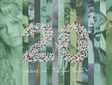
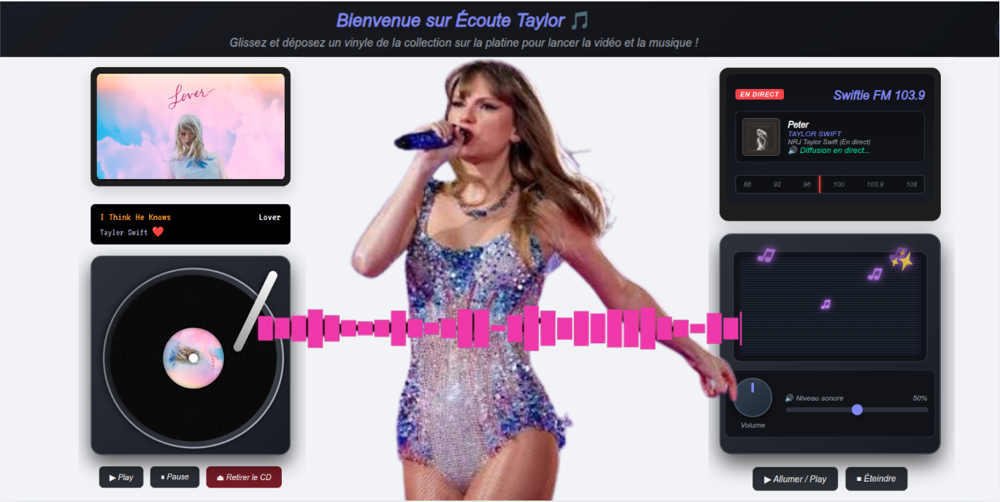

## ✨ Nouveautés

* Nouveau design pour les 20 ans de carrière de Taylor Swift ! Pour célébrer ce moment, le site a obtenu un nouveau design (fond, badge, icon d'app...)
* 
* Venez vite découvrir le site ! ;)
---

# [🎵 Écoute Taylor & Swiftie FM](https://evanber908.github.io/lecteur-cd/)
Une application web immersive et Progressive Web App (PWA) dédiée à l'univers de **Taylor Swift**, regroupant un lecteur de type platine CD/vinyle interactive par album et une web radio en direct 24/7.
`

---

## 🚀 Installation et Lancement Local
* Important : Pour que le Service Worker et les fonctionnalités PWA fonctionnent correctement, le site doit impérativement être exécuté via un serveur web local (et non en ouvrant directement les fichiers avec file://).

---

## ✨ Fonctionnalités

* **Platine CD / Vinyle interactive :** Navigation fluide à travers les albums de Taylor Swift, affichage des pochettes d'albums et listes de pistes dynamiques connectées à YouTube.
* **Web Radio en direct (Swiftie FM 103.9) :** Diffusion en continu de la radio dédiée, avec récupération dynamique des métadonnées en temps réel (titre, artiste, pochette).
* **Intégration Media Session :** Contrôle de la lecture et affichage des pochettes directement sur l'écran de verrouillage et le volet de notification du système (mobile / PC).
* **Progressive Web App (PWA) :** Installable sur mobile et bureau comme une véritable application native grâce au manifeste et au Service Worker.
* **Top titres :** enrgistré sur l'ordinateur, pour le supprimer : Méthode 1 : Depuis le navigateur (Pour les tests de développeur)
Tu n'as même pas besoin de modifier ton code source pour tout effacer :

Ouvre ton site dans ton navigateur.

Appuie sur la touche F12 (ou fais un clic droit n'importe où sur la page et clique sur Inspecter).

Va dans l'onglet Application (sur Google Chrome / Brave) ou Stockage (sur Firefox).

Dans le menu de gauche, cherche Local Storage et clique sur l'adresse de ton site.

Tu verras apparaître ta clé taylorAlbums avec toute la liste enregistrée. Fais un clic droit dessus et clique sur Delete (Supprimer), ou clique sur le bouton d'interdiction pour tout vider (localStorage.clear()).

Actualise ta page (F5), et voilà : le site repart de zéro avec les valeurs d'origine !

---

## 📂 Structure du Projet

```text
├── index.html          # Page principale (Lecteur CD / Albums)
├── radio.html          # Page Web Radio en direct
├── style.css           # Styles globaux et design rétro / vinyle
├── script.js           # Logique du lecteur CD et gestion des albums
├── radio.js            # Logique de la web radio, flux audio et Media Session
├── manifest.json       # Configuration PWA pour l'installation mobile
├── sw.js               # Service Worker pour la validation PWA
├── favicon.svg         # Icône du site
└── icons/              # Icônes de l'application (formats PNG 192x192 et 512x512)
```

---

## 🛠️ Technologies utilisées

* **HTML5 & CSS3** : Structure sémantique et mise en forme (design rétro vinyle/radio).
* **JavaScript (Vanilla)** : Logique interactive des lecteurs et gestion du flux audio.
* **API YouTube & Web API** : Intégration des pistes et gestion des médias (Media Session).
* **PWA (Progressive Web App)** : Manifeste et Service Worker pour l'installation sur l'appareil.

---

## 🔮 Améliorations futures

* [ ] Ajouter de nouveaux albums et clips vidéo.
* [ ] Intégrer un système de favoris ou de playlist personnalisée.
* [ ] Améliorer le design responsive pour les très petits écrans mobiles.
* [ ] Afficher les titres les plus écoutés sur le site

---

## 👥 Auteurs

* **evanber908** - *Création et développement initial* - [Mon Profil GitHub](https://github.com/evanber908)

## 📜 Crédits & Mentions Légales
* Projet personnel de fan sans but lucratif. Les contenus musicaux, les pochettes d'albums et les visuels appartiennent exclusivement à Taylor Swift et à ses ayants droit (Universal Music Group / TAS Rights Management).
* vidéos venant de l'API Youtube
* Radio venat de NRJ Taylor Swift
