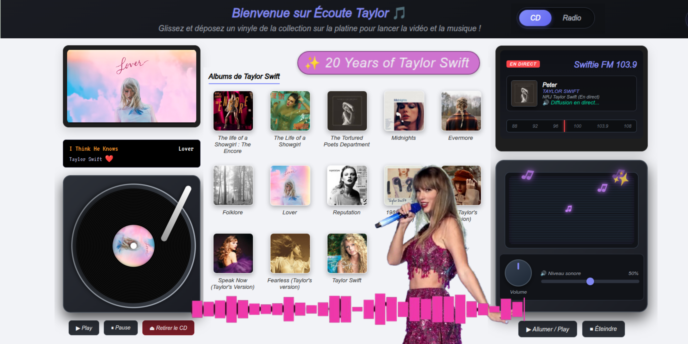
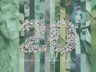

# [🎵 Écoute Taylor](https://evanber908.github.io/lecteur-cd/)

Une application web immersive et **Progressive Web App (PWA)** dédiée à l'univers de **Taylor Swift**, regroupant un lecteur de type platine vinyle interactif par album et une web radio en direct 24/7.

> ✨ **Design spécial 20 ans de carrière de Taylor Swift !** Le site arbore un design exclusif (fond, badge, icône d'app…) pour célébrer cet anniversaire.




---

## 🚀 Lancement rapide

> [!IMPORTANT]
> Le site doit être exécuté via un **serveur web local** (et non en ouvrant directement les fichiers avec `file://`) pour que le Service Worker et les fonctionnalités PWA fonctionnent correctement.

Utilisez par exemple l'extension **Live Server** de VS Code, ou :

```bash
npx serve .
```

Puis ouvrez [http://localhost:3000](http://localhost:3000) dans votre navigateur.

---

## ✨ Fonctionnalités

### 🎛️ Lecteur Platine Vinyle (`index.html`)

- **Platine tourne-disque animée** : Le vinyle tourne et le bras de lecture se positionne lors de la lecture. La pochette de l'album sélectionné s'affiche au centre du disque.
- **Glisser-déposer** : Faites glisser un vinyle depuis le rack et déposez-le sur la platine pour lancer la lecture (sur PC).
- **Clic / Tap** : Un simple clic sur un vinyle lance immédiatement la lecture (sur mobile et PC).
- **Commandes du lecteur** : Boutons ▶ Play, ⏸ Pause et ⏏ Éjecter le CD.
- **Bandeau d'information** : Affiche le titre de la chanson en cours et l'album correspondant.

### 📀 Rack de Vinyles & Albums

- **10 chansons les plus écoutées** : Section accordéon affichant les 10 titres les plus joués, calculés automatiquement à partir de l'historique de lectures enregistré en `localStorage`.
- **Grille des albums** : Tous les albums studio de Taylor Swift sont présentés sous forme de vignettes cliquables.
- **Liste des pistes par album** : Un clic sur un album affiche la liste complète de ses pistes sous forme de vinyles, avec un bouton "← Retour aux albums".
- **Albums disponibles** (du plus récent au plus ancien) :
  - The Life of a Showgirl : The Encore
  - The Life of a Showgirl
  - The Tortured Poets Department
  - Midnights
  - Evermore
  - Folklore
  - Lover
  - Reputation
  - 1989 (Taylor's Version)
  - Red (Taylor's Version)
  - Speak Now (Taylor's Version)
  - Fearless (Taylor's Version)
  - Taylor Swift

### 📻 Web Radio Swiftie FM (`radio.html`)

- **Flux audio en direct 24/7** : Diffusion continue de la radio NRJ Taylor Swift (103.9 MHz).
- **Affichage du titre en cours** : Récupération dynamique des métadonnées (titre, artiste, pochette) via un proxy Cloudflare Workers.
- **Playlist de secours** : En cas de problème réseau, une playlist de fallback prend le relais automatiquement.
- **Cadran de fréquence** : Aiguille animée positionnée sur 103.9 MHz avec animation lors de la lecture.
- **Haut-parleur animé** : Notes de musique flottantes (♪ ♫ ♩ ♬ ✨) s'échappent du haut-parleur pendant la diffusion.
- **Contrôle du volume** : Bouton rotatif et glissière de volume synchronisés (affichage du pourcentage en temps réel).
- **Commandes radio** : Boutons ▶ Allumer / Play et ⏹ Éteindre.
- **Carte d'infos Swiftie FM** : Détails sur la programmation, la fréquence, la qualité audio (320 kbps HD Stéréo) et les crédits.

### 🔔 Intégration Media Session API

- Mise à jour des **métadonnées système** (titre, artiste, album, pochette) lors de chaque changement de piste.
- Contrôle de la lecture depuis l'**écran de verrouillage** et le **volet de notification** (mobile & PC).
- Disponible sur le lecteur CD et la web radio.

### 📱 Progressive Web App (PWA)

- **Installation** sur mobile et bureau comme une application native.
- **Service Worker** (`sw.js`) pour la validation PWA.
- **Manifeste** (`manifest.json`) avec icônes 192×192 et 512×512.

### 🪟 Fenêtre Modale

- Accessible depuis le bas de page via les liens **Mentions Légales**, **Politique de Confidentialité** et **Contact**.
- Fermeture au clic sur le bouton ✕ ou en dehors de la modale.

---

## 📂 Structure du projet

```text
lecteur-cd/
├── img/
│   ├── 20years-of-taylor-swift.png           # Image du bandeau "20 Years"
│   ├── favicon.svg                            # Icône du site (onglet navigateur)
│   ├── icon-192_20years-of-taylor-swift.png  # Icône PWA 192×192
│   ├── icon-512_20years-of-taylor-swift.png  # Icône PWA 512×512
│   ├── reduit_20years-of-taylor-swift.png    # Image réduite pour le README
│   └── screenshot.png                        # Aperçu du site pour le README
├── img attente/                              # Anciennes icônes (archivées)
├── java/
│   ├── script.js                             # Logique du lecteur CD, albums, top titres
│   └── radio.js                              # Logique de la web radio et Media Session
├── index.html                                # Page principale — Lecteur Platine Vinyle
├── radio.html                                # Page Web Radio en direct
├── style.css                                 # Styles globaux (design rétro vinyle / radio)
├── manifest.json                             # Configuration PWA
├── sw.js                                     # Service Worker
└── README.md                                 # Ce fichier
```

---

## 🛠️ Technologies utilisées

| Technologie | Usage |
|---|---|
| **HTML5 & CSS3** | Structure sémantique et design rétro vinyle/radio |
| **JavaScript (Vanilla)** | Lecteur, albums, top titres, radio, animations |
| **YouTube IFrame API** | Lecture des clips et pistes connectées à YouTube |
| **Media Session API** | Affichage sur écran de verrouillage et notifications |
| **Web Audio (HTML5 `<audio>`)** | Flux audio de la radio |
| **Cloudflare Workers** | Proxy pour récupérer les métadonnées NRJ en direct |
| **localStorage** | Persistance du compteur de lectures (top titres) |
| **PWA (Manifeste + Service Worker)** | Installation sur l'appareil |
| **Google Fonts** | Polices VT323 et Caveat |

---

## 🗑️ Réinitialiser le top titres

Le compteur de lectures est enregistré dans le `localStorage` du navigateur. Pour le remettre à zéro :

**Depuis les outils développeur (F12) :**

1. Ouvrez le site et appuyez sur **F12** (ou clic droit → *Inspecter*).
2. Allez dans l'onglet **Application** (Chrome/Brave) ou **Stockage** (Firefox).
3. Dans le menu gauche, cliquez sur **Local Storage** → adresse du site.
4. Trouvez la clé `taylorAlbums`, faites un clic droit → **Delete**, ou videz tout avec `localStorage.clear()` dans la console.
5. Actualisez la page (F5) : le site repart de zéro.

---

## 🔮 Améliorations futures

- [ ] Ajouter de nouveaux albums et clips vidéo.
- [ ] Intégrer un système de favoris ou de playlist personnalisée.
- [ ] Améliorer le design responsive pour les très petits écrans mobiles.
- [x] Afficher les titres les plus écoutés sur le site.

---

## 👤 Auteur

**evanber908** — Création et développement — [Profil GitHub](https://github.com/evanber908)

---

## 📜 Crédits & Mentions légales

Projet personnel de fan, **sans but lucratif**. Les contenus musicaux, pochettes d'albums et visuels appartiennent exclusivement à **Taylor Swift** et à ses ayants droit (Universal Music Group / TAS Rights Management).

- Vidéos intégrées via l'**API YouTube** (Google LLC).
- Flux radio fourni par **NRJ — Taylor Swift** (`streaming.nrjaudio.fm`).
